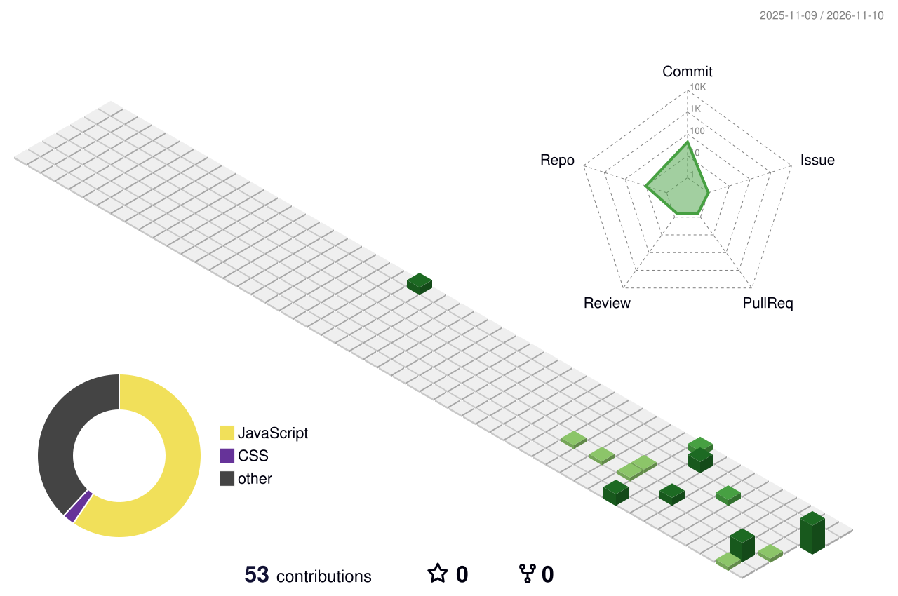

# Anubhav Singh

**Aspiring Data Engineer · B.Sc. Computer Science (2027)**

Prof. Ramkrishna More College, Pune · CGPA 8.45/10

---

## About Me

I'm a third-year Computer Science student building a path into **data engineering**. Right now that means getting comfortable with Python and SQL, cleaning and reshaping data with Pandas, and understanding how databases are designed.

I'm looking for a **data engineering or data analytics internship** where I can learn on real data.

## Tech Stack

| Category | Technologies |
|:--|:--|
| **Languages** |   |
| **Data & ML** |     |
| **Web** |    |
| **Tools** |      |

## Currently Learning

- Advanced SQL and PostgreSQL
- Data cleaning and transformation with Pandas
- ETL pipelines and data modeling
- Apache Airflow and Spark, once the basics are solid

**Up next:** a small pipeline that takes a messy CSV dataset, cleans it with Pandas, and loads it into PostgreSQL.

## Projects

### [3D Sorting Algorithm Visualizer](https://github.com/anubhav98764/YOUR-REPO-NAME)
A web app that shows sorting algorithms as 3D bar graphs. Step through an algorithm one move at a time, or run two algorithms side by side to compare how they behave. Includes user login.

`React.js` · `Node.js` · `MongoDB`

### Sahayak: Elder-Care Assistance Initiative
A team project on coordinating voice-call and field support for elderly people. I worked on the service framework, the problem statement, and the research workflow. Prototyping was done in Figma.

`Figma` · `System Design` · `Research`

## GitHub Stats

<!-- Optional: keep only if the profile-3d-contrib workflow is set up in this repo -->
<!--

-->

---

Let's connect: [LinkedIn](https://www.linkedin.com/in/anubhav-singh-379510373) · [Email](mailto:singhanubhav00013@gmail.com)

